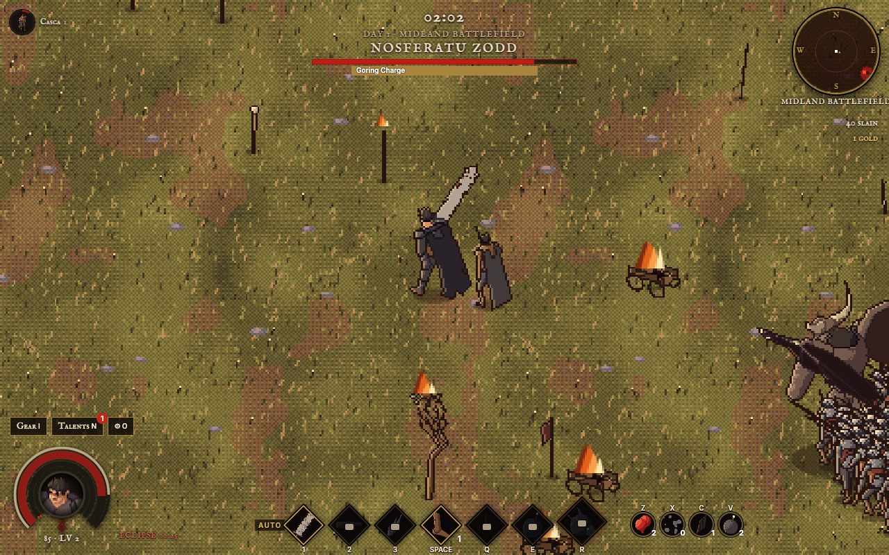
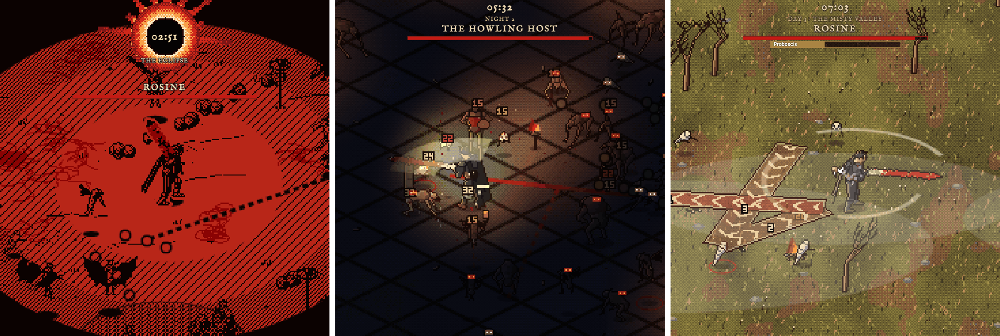

<div align="center">

# berserk

**The Black Swordsman as an endless survivor roguelike.**

Golden age paint by day, a burning Brand that turns the world to ink by night. Cut through the horde, build your run from cards, gear and talents, and see how many nights you last.

[](https://highskore.com/berserk)


[](LICENSE)



</div>

## Features

- **One long arc.** Day 1 is the golden age with the Hawks. The first night is the Eclipse, then Brand nights forever.
- **Two looks.** A painterly golden age by day, black-and-red ink by night, all drawn from 3D figures in software.
- **Apostle bosses.** Nosferatu Zodd, Wyald, Rosine, Grunbeld, the Count and more, each with their own attacks and cast bar.
- **Build your run.** Level-up cards for weapons (some evolve), stats and companions; seven active abilities, up to the Berserker Armor's frenzy.
- **Gear and sets.** Five gear slots, four rarities, uniques with real trade-offs, and two sets: the Berserker Armor and the Band of the Hawk.
- **Talents.** Three trees (Black Swordsman, Struggler, Berserker) with forks, capstones and a node that takes points forever.
- **Between nights.** Spend your gold at Godo's forge and Puck's market, and keep four flasks on quick slots.
- **Pick up and play.** Nothing is saved: each visit starts a fresh run.



## Play

Open [highskore.com/berserk](https://highskore.com/berserk) and press **Take up the sword**. It plays in the browser, on desktop or a phone.

| | Keyboard | Phone |
|---|---|---|
| Move | <kbd>W</kbd><kbd>A</kbd><kbd>S</kbd><kbd>D</kbd> or the arrow keys | Drag anywhere |
| Attack | The Dragonslayer swings on its own | |
| Abilities | <kbd>1</kbd> <kbd>2</kbd> <kbd>3</kbd>, <kbd>Space</kbd> to dash, <kbd>Q</kbd> <kbd>E</kbd>, <kbd>R</kbd> for the Berserker Armor | Tap the ability bar |
| Flasks | <kbd>Z</kbd> <kbd>X</kbd> <kbd>C</kbd> <kbd>V</kbd> | Tap the flask slots |
| Pick a card | <kbd>1</kbd>–<kbd>4</kbd>, or click it | Tap it |
| Gear, talents, settings | <kbd>I</kbd>, <kbd>N</kbd> or <kbd>T</kbd>, <kbd>O</kbd> | The buttons above the health orb |
| Pause | <kbd>P</kbd> or <kbd>Esc</kbd> | |
| Start, continue | <kbd>Enter</kbd> or <kbd>Space</kbd> | |

Abilities can cast themselves; turn that, and auto-casting the ultimate and flasks, on or off in settings.

## Build from source

You need Node. There are no dependencies.

```sh
git clone https://github.com/highskore/berserk.git && cd berserk
node build.mjs            # → dist/berserk.html
node talents-check.mjs    # checks every talent can be reached
```

Open `dist/berserk.html` in a browser. For what each source file does and the test hooks, see [docs/DEVELOPING.md](docs/DEVELOPING.md).

## License

[MIT](LICENSE)
